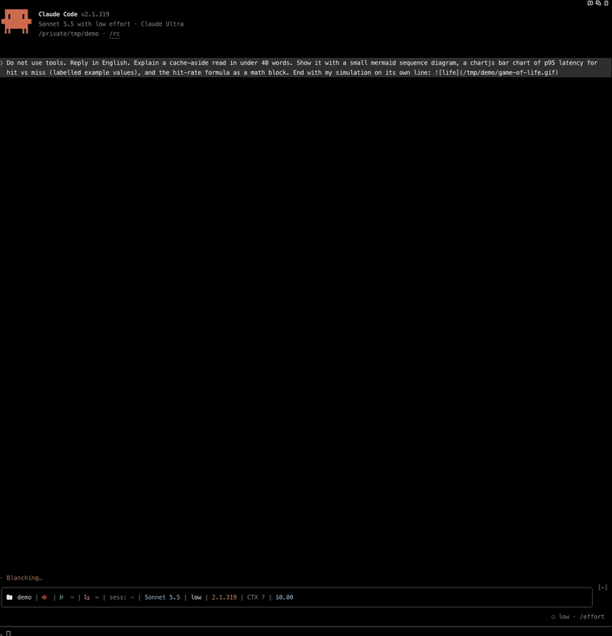
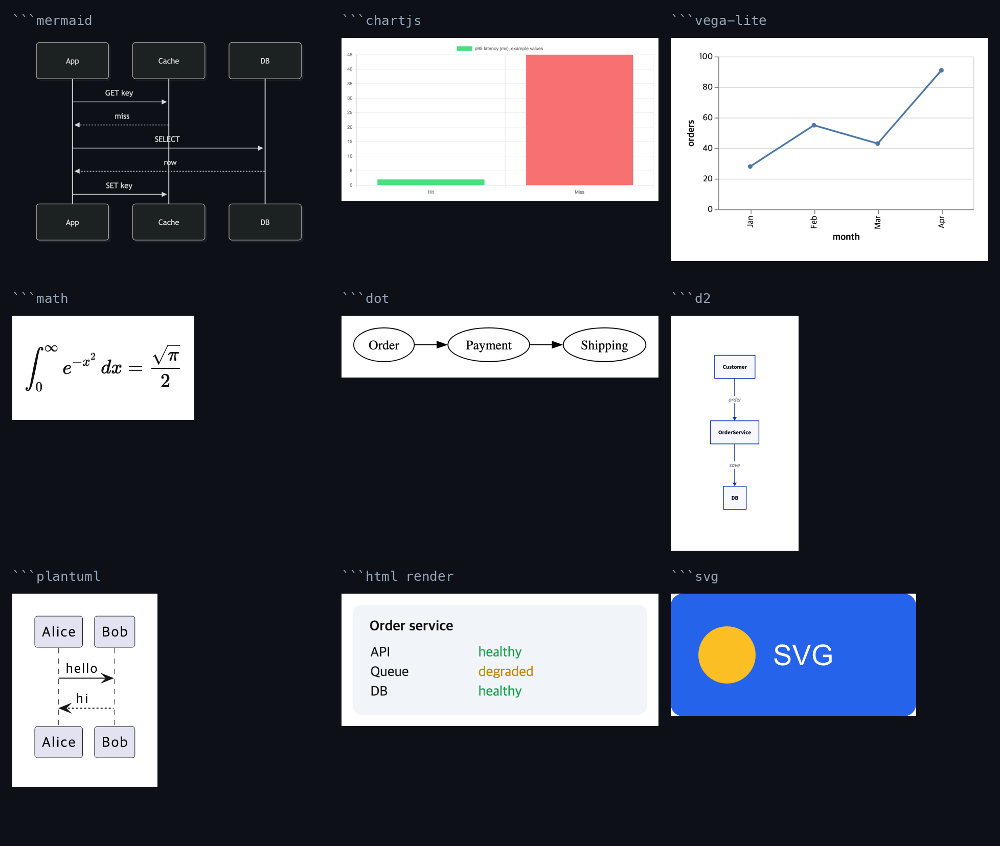

# diagram-view

A Claude Code mod that draws what the model writes as real pictures in the terminal, the way a chat app does.



Claude knows the blocks are there, so it reaches for them on its own. The stored message never changes: only the drawing does.



| Write in a reply | Drawn with | Needs |
| --- | --- | --- |
| ` ```mermaid ` | mermaid-cli | `npm i -g @mermaid-js/mermaid-cli` (`PUPPETEER_SKIP_DOWNLOAD=1` reuses your Chrome) |
| ` ```svg ` | resvg | `brew install resvg` |
| ` ```math `, ` ```latex `, ` ```tex ` | KaTeX (bundled) | Chrome |
| ` ```vega-lite `, ` ```vega ` | Vega (bundled) | Chrome |
| ` ```chartjs ` (config as JSON) | Chart.js (bundled) | Chrome |
| ` ```html render ` | Chrome, no scripts, no network | Chrome |
| ` ```dot `, ` ```graphviz ` | Graphviz | `brew install graphviz`, Chrome |
| ` ```d2 ` | D2 | `brew install d2`, Chrome |
| ` ```plantuml `, ` ```puml ` | PlantUML, sandbox profile | `brew install plantuml`, Chrome |
| `` alone on a line (png, jpg, webp) | ffmpeg | `brew install ffmpeg` |
| `` alone on a line (gif, mp4, mov, webm) | ffmpeg, played 3 times at 10 fps, first 20 seconds | `brew install ffmpeg` |

Install only what you use: a block whose tool is missing stays text, and a toast names the install command.
Chrome is found at its usual path, or set `CHROME_PATH`.

## Install

At the prompt of a terminal session:

```
/plugin install diagram-view --marketplace kimnamwook1/diagram-view
```

Answer `y` to add the marketplace, then pick a scope.

## Terminals

Pictures need the kitty graphics protocol with Unicode placeholders: kitty, Ghostty, or an agent session in [Orca](https://github.com/stablyai/orca). Elsewhere the block's place shows `[diagram ...]`. In Orca, a `claude` started by hand in a plain terminal needs `CLAUDE_CODE_FORCE_TERMINAL_IMAGES=1`.

## How it behaves

- Only the drawing changes. The stored message and what the model reads stay as written; `ctrl+o` shows the source.
- A block shows as text until its picture is ready, and stays text if conversion fails.
- A short section in the system prompt tells the model these blocks exist.
- Pictures are cached in the system temp folder under `diagram-view`.
- A plain ` ```html ` block stays code. Only ` ```html render ` draws.

## Safety

Pictures are made from text the model wrote, so no renderer may reach the network: a remote image in a diagram could otherwise carry data out. HTML draws with scripts off; every Chrome page is offline on `about:blank`, away from local files too. Mermaid runs behind a dead proxy, D2 does not bundle remote icons, PlantUML runs under its `SANDBOX` profile and ffmpeg reads local files only. Math and charts run only the bundled libraries.

## Limits

- Mermaid draws in dark colors and everything else on white, whatever the terminal theme.
- Pictures are static: no hover or click.
- A picture over 2 MiB stays text.
- In Orca, a picture drawn while its tab is hidden stays blank until the tab redraws (`ctrl+l`).

## License

MIT. `vendor/` holds KaTeX and Chart.js (MIT) and Vega and Vega-Lite (BSD-3-Clause), with their licenses beside them.
